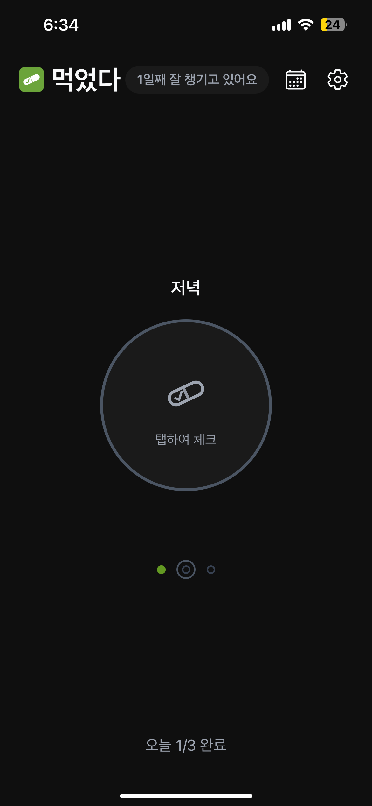
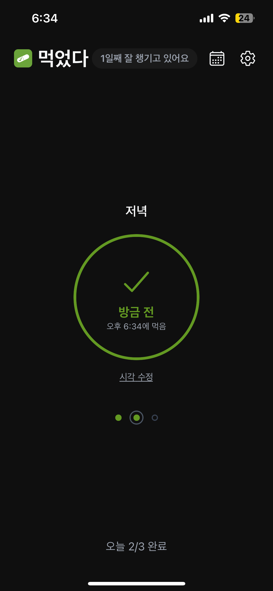
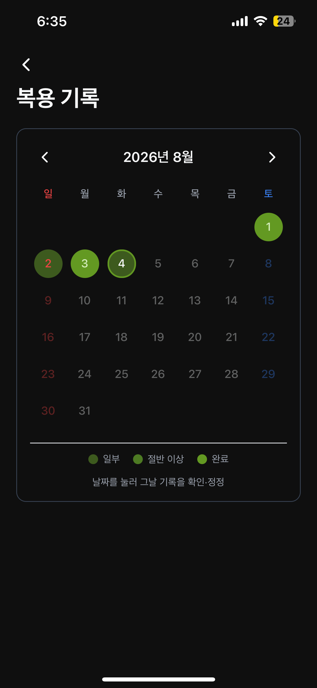
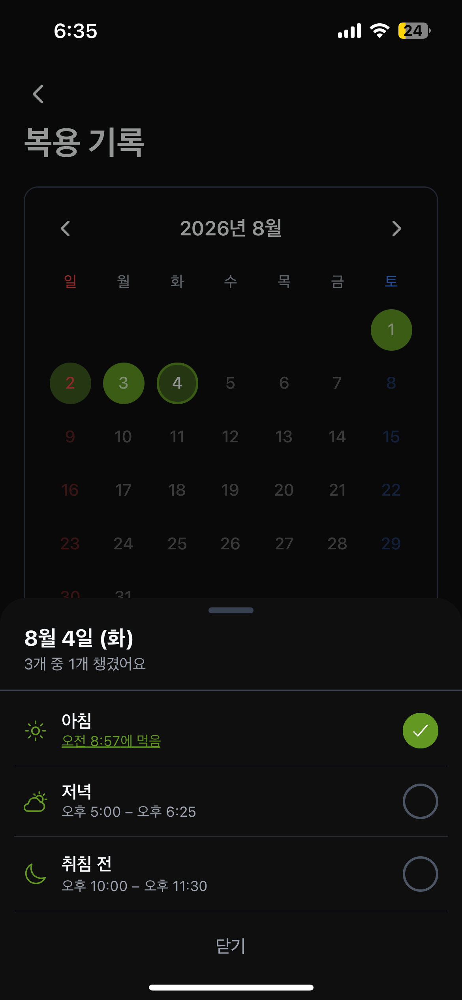
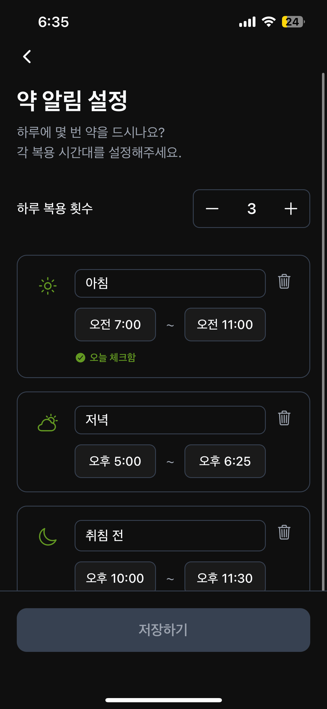

<div align="center">


# 먹었다

**약 먹었는지 _확인_시켜주는 앱.**

이름 "먹었다"가 곧 "먹었나?"의 답입니다.

<br>


</div>

<br>

## 왜 만들었나

약을 챙겨 먹다 보면 진짜 문제는 "약 먹는 걸 잊는 것"이 아니라 **"아까 먹었나?"라는 순간의 불확실성**이었습니다. 아침에 분명 먹은 것 같은데 확신이 안 서고, 다시 먹자니 겹칠까 걱정되는 그 순간이요.

시중의 약 앱은 대부분 **리마인더**입니다 — "약 먹을 시간이에요"라고 재촉하죠. 하지만 그건 "잊는" 문제를 푸는 거고, 정작 "먹었는지 헷갈리는" 문제는 그대로 남습니다.

그래서 재촉하는 앱이 아니라, **켜자마자 "이 약 먹었나?"에 답해주는** 앱을 만들었습니다. 체크한 시각을 기록해 "먹었나?"라는 순간 자체를 없애는 게 목표입니다.

## 핵심 원칙

이 세 가지가 모든 기능 결정의 기준입니다.

1. **즉답성** — 앱을 켜자마자 "지금 이 약 먹었나?"에 바로 답이 보여야 한다.
2. **불확실성 제거** — 체크 시각을 기록해 "먹었나?"라는 순간을 없앤다.
3. **재촉이 아니라 안심** — 압박·죄책감을 주는 연출(과한 스트릭 강조 등)은 지양한다. 기록은 "잘 챙겼다는 증거" 톤으로.

기능을 더할 때마다 이 셋에 부합하는지 먼저 따졌고, 리마인더 앱의 기능을 무분별하게 흡수하지 않았습니다. (실제로 "약을 여러 개 개별 관리"하는 기능을 만들었다가, 이 원칙과 맞지 않아 접은 결정이 커밋 히스토리에 남아 있습니다.)

## 주요 기능

- **탭 한 번 복용 체크** — 큰 원을 눌러 지금 시간대의 약을 먹었다고 기록합니다. 화면의 주인공은 원 하나이고, 그 한 번의 탭이 전부입니다.
- **복용 시각 기록** — "방금 전 / 오전 8:10에 먹음"을 원 안에 보여줍니다. "언제 먹었나"를 화면 밖 라벨이 아니라 시선이 가는 자리에 둬, 중복 복용 직전의 불확실성을 즉시 해소합니다.
- **시간대 네비게이터** — 아침·점심·저녁을 점 인디케이터와 좌우 스와이프로 오갑니다. 수동 순서 없이 시간이 순서를 정하고, "먹음(초록 채움)"과 "현재 위치(바깥 헤일로 링)"를 서로 다른 시각 속성으로 분리해 네 조합이 헷갈리지 않습니다.
- **확인 톤의 알림** — 시간대 종료 시각까지 체크가 없으면 "오늘 아침 챙기셨어요?"라고 묻습니다. 재촉이 아니라 확인이고, 이미 먹었으면 오지 않습니다. 앱을 며칠 안 열어도 끊기지 않도록 여러 날치를 미리 예약합니다.
- **알림 탭 → 해당 약으로** — 오늘 알림은 메인의 그 시간대로, 지난 알림은 그날을 정정하는 캘린더로 데려갑니다.
- **복용 기록 캘린더 + 지난 날짜 정정** — 날짜별 완료 정도를 초록 농도로 보여주고, 날짜를 눌러 깜빡한 체크를 바로잡습니다. 시각은 몰라도 "챙김"만 표시할 수 있어, 모르는 시각을 지어내지 않습니다.

## 설계에서 신경 쓴 것

- **저장소 계층 추상화** — 화면은 저장 구현을 직접 모릅니다. `MedRepository` 인터페이스에만 의존하고, 현재는 로컬(`react-native-mmkv`), 추후 클라우드 동기화는 드롭인으로 교체할 수 있게 설계했습니다.
- **동기화 대비 데이터 모델** — 클라우드를 아직 안 붙였지만 고정 UUID, 날짜(ISO) 키, 소프트 삭제(`deletedAt`) 규칙을 지킵니다.
- **테스트 가능한 순수 로직** — 활성 슬롯 선택(`pickActive`), 연속 기록(`streak`), 날짜별 유효 슬롯(`slotsForDate`), 정렬 등을 UI에서 분리해 순수 함수로 뒀습니다.
- **접근성** — 모든 체크 요소에 `accessibilityLabel`·`accessibilityState`를 부여했습니다.
- **한국어/영어 · 다크 모드** — 기기 설정을 따릅니다.

## 기술 스택

- **Expo** (React Native) + **TypeScript** (strict)
- **expo-router** — 파일 기반 라우팅
- **react-native-mmkv** — 로컬 저장 (Repository 계층 뒤)
- **expo-notifications** · **expo-haptics**

## 스크린샷

<table>
  <tr>
    <td align="center" width="25%"><br /><sub>메인 · 미복용</sub></td>
    <td align="center" width="25%"><br /><sub>메인 · 복용 완료</sub></td>
    <td align="center" width="25%"><br /><sub>캘린더</sub></td>
    <td align="center" width="25%"><br /><sub>지난 날짜 정정</sub></td>
  </tr>
</table>

<details>
<summary>시간대 설정 화면</summary>

<br />



</details>

## 로컬 실행

```bash
# Node 22 이상 필요
npm install

# 개발 서버 (Expo Go / 시뮬레이터)
npx expo start

# iOS 시뮬레이터에 직접 빌드
npx expo run:ios
```

## 라이선스

[MIT](./LICENSE)
